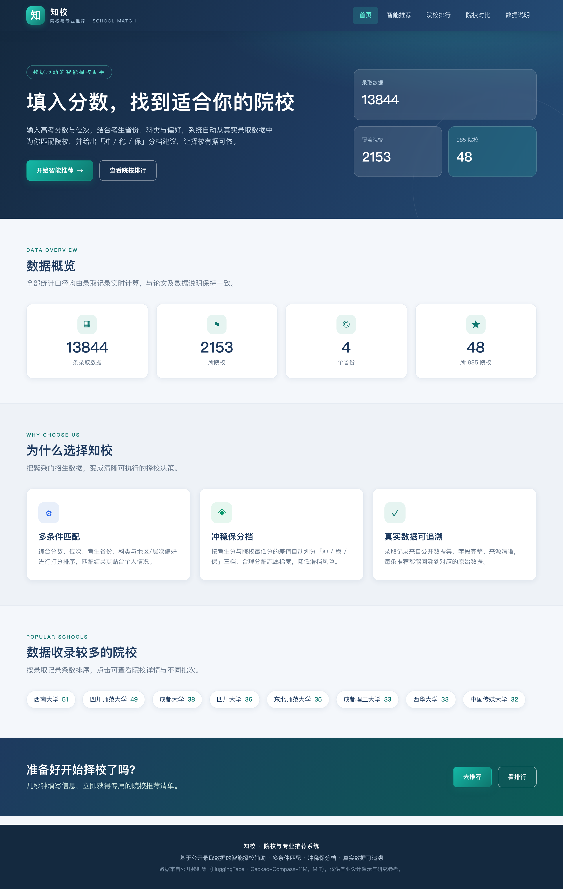
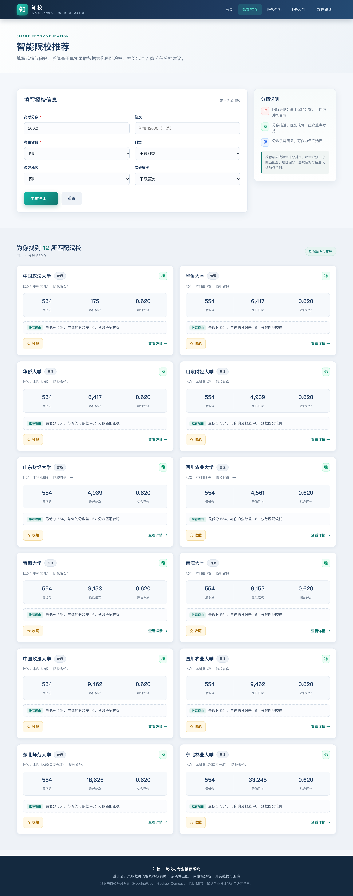
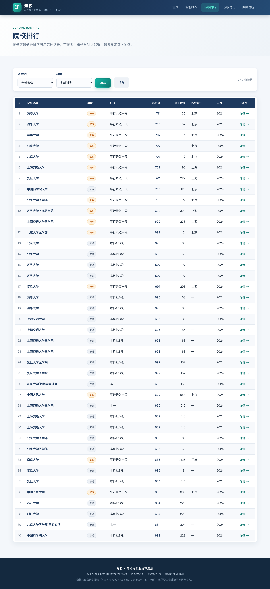
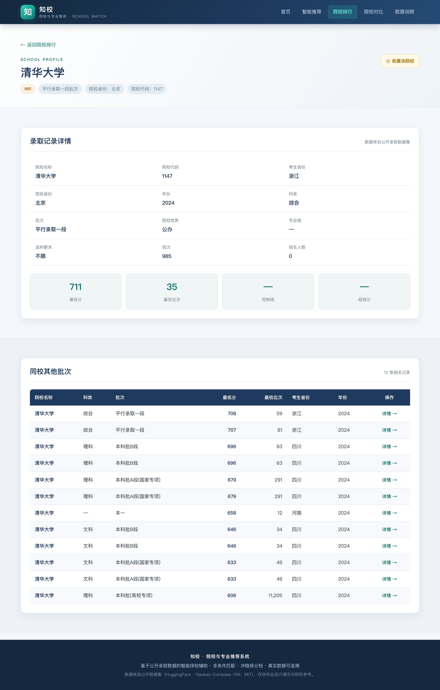
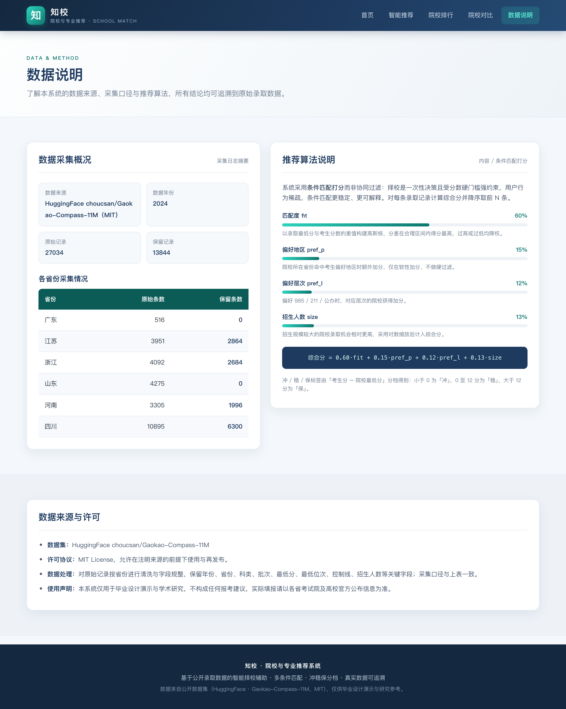

# 043 基于 Django 的考研院校与专业推荐系统-设计展示

> **代码有偿获取 可接受定制 微信联系方式: csbysj2020 或 ACE2487，备注(BS)**

> **完整源码与全套文档 · 在线自助获取 >>> [https://mbd.pub/o/bread/YZaWl51tbQ==](https://mbd.pub/o/bread/YZaWl51tbQ==)**

> **成品页（功能介绍 / 更多选题）>>> [https://bishe.suilang.net/products/school-match](https://bishe.suilang.net/products/school-match)**

> 

> 

## 视频

> **点击查看 >>> [https://www.bilibili.com/video/BV1jns16XESk/](https://www.bilibili.com/video/BV1jns16XESk/)**

## 项目简介

用真实录取数据做可解释的择校推荐：公开数据集 13844 条本科批记录、2153 所院校、4 个省份。填分数、位次与偏好，按匹配度+地区+层次+招生规模加权，给出冲/稳/保三档建议，每条附理由。不用协同过滤——择校是分数硬门槛下的一次性决策，条件匹配更稳更可解释。

院校与专业选择是考研备考中的关键决策，考生在分数、位次、科类、目标地区与院校层次等多重约束下，需要在大量院校中做出一次性选择。

本项目设计并实现了一套基于 Django 的院校推荐系统：以公开数据集HuggingFace choucsan/Gaokao-Compass-11M（MIT） 中的真实录取记录为基础，清洗后得到 2024 年 4 个省份的13844 条本科批录取数据，覆盖 2153 所院校，最低分介于 376 至711 之间，均分 530.3，其中 985 院校 48 所、211 院校 127 所。

系统实现了多条件匹配推荐算法：给定分数、位次、省份、科类与偏好地区/层次，对每条记录计算综合分 = 0.6·分差匹配度（高斯核，期望分差 +6）+ 0.15·地区偏好 + 0.12·层次偏好 +0.13·招生规模（log 缩放），按总分降序输出 TopN，并给出冲/稳/保分档与可解释理由。

本仓库为**设计展示**：包含项目说明、技术架构、实验结果与运行截图；完整源码、任务书、开题报告、毕业论文与使用说明可通过上方链接自助获取，成品页可查看更多选题，也可联系微信咨询定制。

## 功能特性

1. 真实数据：HuggingFace 公开数据集 Gaokao-Compass-11M（MIT），13844 条本科批录取记录

2. 多条件推荐：匹配度(0.6)+地区偏好(0.15)+层次偏好(0.12)+招生规模(0.13) 加权

3. 冲/稳/保分档：按考生分与院校最低分之差分档，每条推荐附可核对理由

4. 数据覆盖 2153 所院校 / 4 省份 / 48 所 985 / 127 所 211，分数 376–711

5. 院校排行按最低分排序、省份科类筛选；详情页展示完整字段与同校其它批次

6. 院校对比：最多 4 所并排比较关键信息；收藏夹记录心仪院校

7. 数字单一来源：页面与论文读 data/stats.json，重跑导入命令即可同步

## 技术架构

| 项目 | 说明 |
| --- | --- |
| 编程语言 | Python 3.8 及以上 |
| Web 框架 | Django 4.2（默认 SQLite，免装数据库） |
| 推荐算法 | 内容匹配（高斯分差核 + 偏好加权），非协同过滤 |
| 前端 | Django 模板 + ECharts |
| 样本规模 | 13844 条 / 2153 所院校 / 4 省 |
| 运行端口 | http://127.0.0.1:8000 |
| 演示账号 | admin / admin123456 |

## 目录结构

以下为完整交付版的结构（本仓库仅作设计展示）：

```
school-match/
├── 任务书/
│   └── 毕业设计任务书.docx
├── 开题报告/
│   └── 毕业设计开题报告.docx
├── 最终论文/
│   ├── 图/
│   │   └── fig-arch.png
│   └── 基于Django的考研院校与专业推荐系统设计与实现.docx
├── 源码/
│   ├── crawler/
│   │   ├── __init__.py
│   │   ├── fetch_data.py
│   │   └── merge_data.py
│   ├── data/
│   │   ├── raw/
│   │   └── stats.json
│   ├── reco/
│   │   ├── __init__.py
│   │   ├── settings.py
│   │   ├── urls.py
│   │   └── wsgi.py
│   ├── schools/
│   │   ├── management/
│   │   ├── migrations/
│   │   ├── __init__.py
│   │   ├── admin.py
│   │   ├── apps.py
│   │   ├── models.py
│   │   ├── recommender.py
│   │   └── views.py
│   ├── static/
│   │   └── css/
│   ├── templates/
│   │   ├── about.html
│   │   ├── base.html
│   │   ├── compare.html
│   │   ├── detail.html
│   │   ├── home.html
│   │   ├── rank.html
│   │   └── recommend.html
│   ├── db.sqlite3
│   └── manage.py
└── …
```

## 数据与实验结论

- 真实数据：HuggingFace 公开数据集 Gaokao-Compass-11M（MIT），13844 条本科批录取记录
- 多条件推荐：匹配度(0.6)+地区偏好(0.15)+层次偏好(0.12)+招生规模(0.13) 加权
- 数据覆盖 2153 所院校 / 4 省份 / 48 所 985 / 127 所 211，分数 376–711
- 院校对比：最多 4 所并排比较关键信息；收藏夹记录心仪院校

## 交付内容

1. 完整源码（Django 工程 + 推荐引擎 + 数据导入脚本）
2. 真实录取数据 13844 条与 SQLite 数据库
3. 一键启动脚本（macOS / Windows）
4. 毕业设计任务书（Word）、开题报告（Word）
5. 毕业论文（Word，七章制，含架构图与首页截图）
6. 系统使用与二次开发说明（Word + md，12 节）
7. 5 张界面截图、论文配图、封面、演示视频

## 常见问题

**数据是爬的吗？能更新吗？**

数据来自 HuggingFace 公开数据集 Gaokao-Compass-11M（MIT），非爬取高校网站。重跑 crawler/fetch_data.py → merge_data.py → manage.py import_admission 即可更新。

**为什么不用协同过滤？**

择校是分数硬门槛下的一次性决策，用户行为稀疏；条件匹配更稳、更可解释，论文第6章与电影/Steam推荐做了对比。

**冲/稳/保怎么分？**

按考生分减院校最低分：<0 冲、0~12 稳、>12 保；具体档位随推荐结果一起给出。

**推荐结果能追溯吗？**

每条推荐都来自真实录取记录，可点进详情页查看原始字段。

**能换 MySQL 吗？**

设 DB_ENGINE=mysql 及 DB_NAME/DB_USER/DB_PASSWORD 后 migrate 即可，默认 SQLite 免安装。

**怎么调推荐权重？**

编辑 schools/recommender.py 里 recommend() 的四项权重（0.6/0.15/0.12/0.13），重开服务即可。

## 截图






